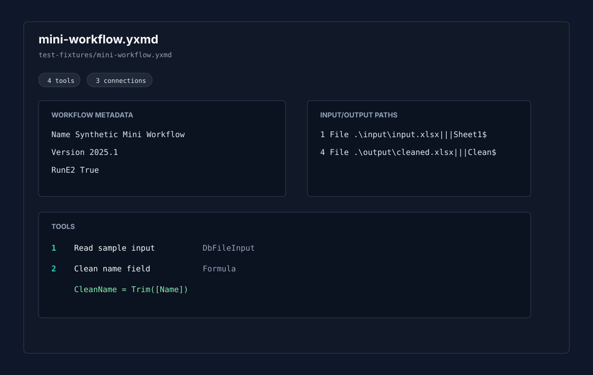
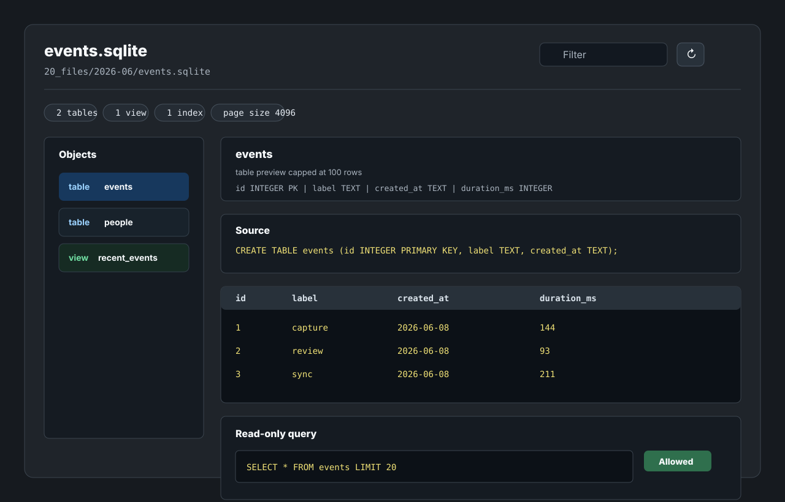

# Viggo Meesters

Data & systems innovator · Netherlands

[LinkedIn](https://www.linkedin.com/in/viggomeesters/) · [All projects](https://github.com/viggomeesters?tab=repositories)

## Selected projects

### [Ruycast](https://github.com/viggomeesters/ruycast)

A native Mac launcher with a Rust core, a CLI and configuration you control. **Rust native beta · macOS 14+**

### [Alteryx Viewer](https://github.com/viggomeesters/obsidian-alteryx-viewer)

Inspect Alteryx workflows, tools and connections in Obsidian without executing the workflow.

### [SQL Viewer](https://github.com/viggomeesters/obsidian-sql-viewer)

Browse local SQLite tables, schemas and capped query results in Obsidian. Read-only and local-only.

## GitHub activity

Public activity snapshot · 16 November 2026 · [Source and refresh](docs/maintenance.md)
